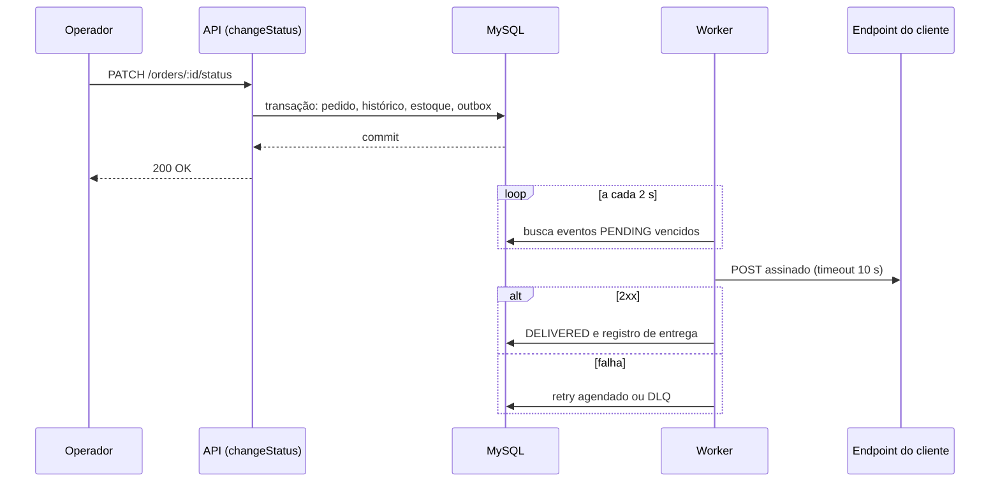
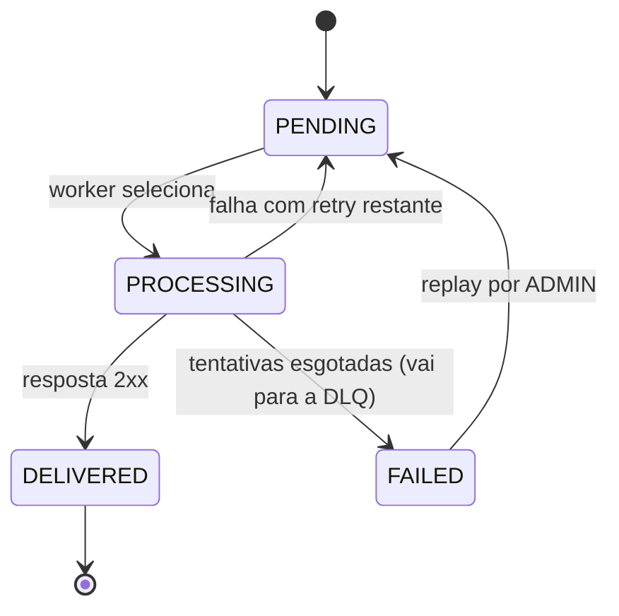

### FDD: Sistema de Webhooks de Notificação de Pedidos

Versão: 1.0
Data: 2026-11-11
Responsável: Larissa (Tech Lead), a confirmar

> Documento de implementação. A proposta e as alternativas estão no [RFC](RFC.md), as decisões nos [ADRs](adrs/README.md) e o contexto de produto no [PRD](PRD.md). Trechos como [09:02] Marcos indicam a fala da reunião (`TRANSCRICAO.md`) que originou o item. Itens marcados como **(derivado)** ou **hipótese** são escolhas deste FDD, sem fala literal na reunião, e precisam de confirmação na revisão. A seção 11, "Integração com o sistema existente", é exigida pelo enunciado do desafio e complementa o modelo.

---

### 1. Contexto e motivação técnica

Clientes B2B precisam saber em menos de 10 s quando o status de um pedido muda ([09:02] Marcos). Hoje a única fonte é `GET /orders` ([09:00] Marcos).

A mudança de status ocorre em `OrderService.changeStatus` (`src/modules/orders/order.service.ts`), numa transação Prisma que atualiza `orders`, insere em `order_status_history` e debita ou repõe `stock_quantity`. O envio HTTP não pode ficar nessa transação: um cliente lento travaria outros pedidos e um cliente offline forçaria rollback ([09:04] Bruno). Por isso o evento é gravado numa outbox na mesma transação e enviado por um worker à parte ([ADR-001](adrs/ADR-001-outbox-no-mysql.md), [ADR-005](adrs/ADR-005-worker-separado-em-polling.md)).

**Encaixe no HLD.** A arquitetura geral está na seção 3 do [RFC](RFC.md): monólito modular existente mais um segundo processo (worker), mesmo banco e mesma base de código.

**Atores.** Cliente B2B (usuário autenticado com JWT), administrador (`ADMIN`), operador que altera status de pedidos, worker e o endpoint https do cliente.

**Suposições e restrições.**
- Ordenação garantida só por `order_id` e só com um worker ([09:13] Larissa).
- At-least-once: duplicidades são esperadas ([09:24] Diego).
- Nenhuma infraestrutura nova ([09:07] Diego).
- Hipótese: Node 20 ou superior, pelo `@types/node` 20 do projeto, o que permite usar `fetch` nativo.

---

### 2. Objetivos técnicos

- Registrar o evento de forma atômica com a mudança de status. Invariante: pedido mudou se e somente se o evento existe ([09:06] Diego).
- Entregar em menos de 10 s no caso saudável. Medida: tempo entre o commit e a chamada ao cliente; polling de 2 s no pior caso ([09:09] Diego).
- Garantir at-least-once com deduplicação por `X-Event-Id`. Invariante: nenhum evento confirmado na outbox é descartado sem passar pela DLQ ([ADR-004](adrs/ADR-004-entrega-at-least-once-com-x-event-id.md)).
- Autenticar a origem e a integridade das chamadas. Medida: HMAC-SHA256 do corpo com secret única por endpoint ([ADR-003](adrs/ADR-003-hmac-sha256-secret-por-endpoint.md)).
- Reusar os padrões do projeto. Medida: nenhuma dependência nova e erros derivados de `AppError` ([ADR-006](adrs/ADR-006-reuso-dos-padroes-do-projeto.md)).

---

### 3. Escopo e exclusões

**Incluído**
- Tabelas de configuração, outbox, entregas e DLQ.
- Função `publishWebhookEvent` e sua chamada em `changeStatus`.
- Módulo `src/modules/webhooks`: CRUD, rotação de secret, deliveries e replay de DLQ.
- Worker com polling, retry, backoff e DLQ (`src/worker.ts`).
- Assinatura HMAC-SHA256 e headers de envio.

**Excluído (decisões da reunião)**
- Aviso por e-mail ao cliente em caso de falha ([09:37] Larissa).
- Rate limiting de saída por cliente: observar e decidir depois ([09:39] Larissa).
- Dashboard visual para o cliente ([09:40] Larissa).
- Arquivamento de linhas entregues da outbox ([09:08] Diego).
- Múltiplos workers e ordenação global ([09:13] Larissa).
- Webhooks de entrada, com o cliente enviando para a plataforma ([09:02] Marcos).

---

### 4. Fluxos detalhados e diagramas

**Fluxo principal**

1. **Criação do evento na outbox.** `changeStatus` valida existência, transição e estoque. Depois de gravar o histórico, chama `publishWebhookEvent(tx, order, from, to)`, que busca os `webhook_endpoints` ativos do `order.customerId` cujo `events` contém `to` ([09:34] Bruno). Para cada endpoint insere uma linha em `webhook_outbox` com `status = PENDING`, `event_id = uuid()` e o payload renderizado com o estado atual do pedido ([09:52] Larissa). Qualquer exceção desfaz a transação inteira ([09:40] Bruno).
2. **Leitura pelo worker.** `src/worker.ts` cria seu próprio `PrismaClient` ([09:30] Bruno) e, a cada 2 s, seleciona um batch pequeno de eventos `PENDING` com `next_attempt_at <= now`, ordenados por `created_at` ([09:09] Diego). Tamanho inicial do batch: 10, configurável **(derivado)**. Marca cada evento como `PROCESSING`.
3. **Envio.** Monta os headers e a assinatura (seção 5, contrato 8) e faz `POST` na URL do endpoint com timeout de 10 s ([09:42] Diego).
4. **Resultado.** Resposta 2xx grava um registro em `webhook_deliveries` com `success = true` e marca o evento `DELIVERED`. Qualquer outro resultado é falha: grava a entrega com `success = false` e segue para o retry.

**Fluxos alternativos e exceções**

- **Retry.** Falha na tentativa `n` com tentativas restantes: `attempt_count` aumenta, `status` volta a `PENDING` e `next_attempt_at = now + atraso`, na progressão abaixo ([09:17] Diego).

  | Retry | Atraso até a tentativa |
  | --- | --- |
  | 1 | 1 minuto |
  | 2 | 5 minutos |
  | 3 | 30 minutos |
  | 4 | 2 horas |
  | 5 | 12 horas |

  A soma é de 14 h 36 min, os "quase 15 horas" da reunião. Interpretação **(derivada)**: 1 tentativa inicial mais 5 retries; confirmar com Diego (RFC, questão 5).
- **DLQ.** Esgotados os retries, em uma transação: `webhook_outbox.status = FAILED`; insere em `webhook_dead_letter` com payload, `failure_reason` (código `WEBHOOK_*` mais detalhe) e `failed_at` ([09:18] Diego); registra o log `webhook_moved_to_dlq`.
- **Replay manual.** `POST /admin/webhooks/dead-letter/:id/replay` (role `ADMIN`) carrega o item da DLQ, recoloca o evento na outbox como `PENDING` com `attempt_count = 0` e `next_attempt_at = now`, mantendo o mesmo `event_id` **(derivado)** para o cliente poder deduplicar. Preenche `replayed_at` e `replayed_by_id` e registra `webhook_dead_letter_replayed` com o id do usuário ([09:36] Sofia).
- **Payload acima de 64 KB.** O worker não envia: vai direto para a DLQ com `WEBHOOK_PAYLOAD_TOO_LARGE` e sem retry **(derivado: a reunião disse "erra", sem definir onde)** ([09:23] Sofia, [09:24] Larissa).
- **Webhook sem interessados.** Nenhuma linha é inserida na outbox.
- **Evento preso em `PROCESSING` por queda do worker.** O at-least-once absorve o reenvio **(derivado)**; o critério de recuperação (por exemplo, voltar a `PENDING` após um limite de tempo) está nas questões em aberto do RFC.

**Modelo de dados de suporte** (novos modelos em `prisma/schema.prisma`, no padrão `@id @default(uuid()) @db.Char(36)`, `@@map` em snake_case e `createdAt`/`updatedAt`)

| Tabela | Campos principais |
| --- | --- |
| `webhook_endpoints` | `id`, `customer_id` (FK `customers`), `url`, `secret`, `previous_secret` e `previous_secret_expires_at` **(derivados, suporte à rotação)**, `events` (lista de `OrderStatus`), `active`, `created_at`, `updated_at` ([09:21] Bruno, [09:33] Marcos) |
| `webhook_outbox` | `id`, `event_id` (UUID único), `webhook_id` **(derivado: uma linha por endpoint)**, `order_id`, `event_type`, `payload` (JSON snapshot), `status` (`PENDING`, `PROCESSING`, `FAILED`, `DELIVERED`), `attempt_count` e `next_attempt_at` **(derivados, necessários ao backoff)**, `created_at`. Índices em `status` e `created_at` ([09:08] Diego) |
| `webhook_deliveries` **(derivado)** | `id`, `outbox_id`, `webhook_id`, `attempt`, `success`, `status_code`, `response_body` (truncado), `duration_ms`, `error_code`, `created_at`. Sustenta o histórico de entregas ([09:34] Marcos) |
| `webhook_dead_letter` | `id`, `outbox_id`, `webhook_id`, `payload`, `failure_reason`, `failed_at`, `replayed_at` e `replayed_by_id` **(derivados, auditoria do replay)** ([09:18] Diego, [09:36] Sofia) |

**Diagramas**

Sequência do envio:



Estados do evento na outbox:



---

### 5. Contratos públicos (assinaturas, endpoints, headers, exemplos)

Prefixo base: `/api/v1` (conforme `src/app.ts`). Os contratos 1 a 7 exigem `Authorization: Bearer <JWT>` (`authenticate`). O formato de erro é o do error middleware: `{ "error": { "code", "message", "details?" } }`. O caminho de rotação de secret é **(derivado)**, pois a reunião só falou em "endpoint pro cliente conseguir pedir nova secret" ([09:21] Sofia). Versionamento: sob `/api/v1`, como os demais módulos.

**Contrato 1: cadastrar webhook** ([09:31] Marcos)
- Tipo: endpoint
- Assinatura/Rota: `POST /api/v1/webhooks`
- Método: POST
- Semântica de status/headers:
  - `201`: criado; a secret só aparece nesta resposta.
  - `400 VALIDATION_ERROR` ou `WEBHOOK_INVALID_URL`: dados inválidos ou URL que não é https.
  - `404 NOT_FOUND`: customer inexistente.
  - `401`: JWT ausente ou inválido.
  - Qualquer role autenticada pode chamar ([09:37] Sofia). O `customerId` vai no body, não no JWT ([09:32] Larissa).

Exemplo de requisição
```json
{
  "customerId": "5b1f2a0e-7c9d-4e55-9a3c-1f0f6a2b8d11",
  "url": "https://api.atlascomercial.example/hooks/pedidos",
  "events": ["SHIPPED", "DELIVERED"]
}
```

Exemplo de resposta
```json
{
  "id": "c2f0a7de-3b1e-4a55-8f0a-6d9a41e0b7aa",
  "customerId": "5b1f2a0e-7c9d-4e55-9a3c-1f0f6a2b8d11",
  "url": "https://api.atlascomercial.example/hooks/pedidos",
  "events": ["SHIPPED", "DELIVERED"],
  "active": true,
  "secret": "<gerada pela plataforma>",
  "createdAt": "2026-11-11T12:00:00.000Z"
}
```

**Contrato 2: listar webhooks de um customer** ([09:33] Bruno)
- Tipo: endpoint
- Assinatura/Rota: `GET /api/v1/webhooks?customerId=...`
- Método: GET
- Semântica de status/headers:
  - `200`: lista paginada no formato de `src/shared/http/response.ts`; a secret nunca é devolvida.
  - `400 VALIDATION_ERROR`: filtro inválido.
  - `401`.

Exemplo de requisição: sem body; query `customerId=5b1f2a0e-7c9d-4e55-9a3c-1f0f6a2b8d11&page=1&pageSize=20`.

Exemplo de resposta
```json
{
  "data": [
    {
      "id": "c2f0a7de-3b1e-4a55-8f0a-6d9a41e0b7aa",
      "customerId": "5b1f2a0e-7c9d-4e55-9a3c-1f0f6a2b8d11",
      "url": "https://api.atlascomercial.example/hooks/pedidos",
      "events": ["SHIPPED", "DELIVERED"],
      "active": true
    }
  ],
  "pagination": { "page": 1, "pageSize": 20, "total": 1, "totalPages": 1 }
}
```

**Contrato 3: editar webhook** ([09:33] Bruno)
- Tipo: endpoint
- Assinatura/Rota: `PATCH /api/v1/webhooks/:id`
- Método: PATCH
- Semântica de status/headers:
  - `200`: atualizado.
  - `400 VALIDATION_ERROR` ou `WEBHOOK_INVALID_URL`.
  - `404 WEBHOOK_NOT_FOUND`.
  - `401`.

Exemplo de requisição
```json
{ "events": ["PAID", "SHIPPED", "DELIVERED"], "active": true }
```

Exemplo de resposta
```json
{
  "id": "c2f0a7de-3b1e-4a55-8f0a-6d9a41e0b7aa",
  "url": "https://api.atlascomercial.example/hooks/pedidos",
  "events": ["PAID", "SHIPPED", "DELIVERED"],
  "active": true
}
```

**Contrato 4: remover webhook** ([09:33] Bruno)
- Tipo: endpoint
- Assinatura/Rota: `DELETE /api/v1/webhooks/:id`
- Método: DELETE
- Semântica de status/headers:
  - `204 No Content`, como `DELETE /orders/:id`.
  - `404 WEBHOOK_NOT_FOUND`.
  - `401`.

Exemplo de requisição: sem body.
Exemplo de resposta: corpo vazio, status `204`.

**Contrato 5: rotacionar a secret** **(caminho derivado)** ([09:21] Sofia)
- Tipo: endpoint
- Assinatura/Rota: `POST /api/v1/webhooks/:id/secret/rotate`
- Método: POST
- Semântica de status/headers:
  - `200`: nova secret devolvida; a anterior segue válida por 24 h a partir da rotação.
  - `404 WEBHOOK_NOT_FOUND`.
  - `401`.

Exemplo de requisição: sem body.

Exemplo de resposta
```json
{
  "id": "c2f0a7de-3b1e-4a55-8f0a-6d9a41e0b7aa",
  "secret": "<nova secret>",
  "previousSecretExpiresAt": "2026-11-12T12:00:00.000Z"
}
```

**Contrato 6: histórico das últimas 100 entregas** ([09:34] Marcos)
- Tipo: endpoint
- Assinatura/Rota: `GET /api/v1/webhooks/:id/deliveries`
- Método: GET
- Semântica de status/headers:
  - `200`: até 100 entregas mais recentes, com sucesso ou falha, payload, resposta e tempo.
  - `404 WEBHOOK_NOT_FOUND`.
  - `401`.

Exemplo de requisição: sem body.

Exemplo de resposta
```json
{
  "data": [
    {
      "eventId": "7d0c4c2a-91a0-4b0c-b0a1-2c6e3b2f5d10",
      "attempt": 1,
      "success": false,
      "statusCode": 503,
      "durationMs": 1240,
      "payload": { "event_type": "order.status_changed", "to_status": "SHIPPED" },
      "responseBody": "Service Unavailable",
      "createdAt": "2026-11-11T12:05:03.000Z"
    }
  ]
}
```

**Contrato 7: replay de item da DLQ** ([09:18] Diego, [09:35] Diego)
- Tipo: endpoint
- Assinatura/Rota: `POST /api/v1/admin/webhooks/dead-letter/:id/replay`
- Método: POST
- Semântica de status/headers:
  - `200`: evento recolocado como `PENDING`.
  - `401`: sem JWT válido.
  - `403 FORBIDDEN`: role diferente de `ADMIN` (`requireRole('ADMIN')`, [09:36] Larissa).
  - `404 WEBHOOK_DEAD_LETTER_NOT_FOUND`.
  - `409 WEBHOOK_DEAD_LETTER_ALREADY_REPLAYED` **(derivado)**.

Exemplo de requisição: sem body.

Exemplo de resposta
```json
{
  "deadLetterId": "e9a1b3c4-1d2e-4f50-9a8b-7c6d5e4f3a2b",
  "eventId": "7d0c4c2a-91a0-4b0c-b0a1-2c6e3b2f5d10",
  "status": "PENDING",
  "replayedById": "a1b2c3d4-0000-4000-8000-000000000001"
}
```

**Contrato 8: requisição de saída ao cliente** ([09:44] Diego, [09:44] Sofia, [09:45] Diego)
- Tipo: HTTP de saída (webhook)
- Assinatura/Rota: `POST <url do webhook>`
- Método: POST
- Limites: timeout de 10 s ([09:42] Diego); payload de no máximo 64 KB ([09:24] Larissa); sem limite de taxa nesta fase ([09:39] Larissa).
- Semântica de status/headers:
  - `Content-Type: application/json`.
  - `X-Event-Id`: UUID do evento, para deduplicação.
  - `X-Signature`: HMAC-SHA256 do corpo bruto, com a secret do endpoint.
  - `X-Timestamp`: momento do envio, para detecção de replay.
  - `X-Webhook-Id`: id do cadastro de webhook.
  - Resposta 2xx do cliente: entregue. Qualquer outro status ou timeout: falha, com retry.

Exemplo de requisição
```json
{
  "event_id": "7d0c4c2a-91a0-4b0c-b0a1-2c6e3b2f5d10",
  "event_type": "order.status_changed",
  "timestamp": "2026-11-11T12:05:00.000Z",
  "order_id": "9a7c2d1e-4b5f-4c6d-8e7f-0a1b2c3d4e5f",
  "order_number": "ORD-000123",
  "from_status": "PROCESSING",
  "to_status": "SHIPPED",
  "customer_id": "5b1f2a0e-7c9d-4e55-9a3c-1f0f6a2b8d11",
  "total_cents": 125000
}
```

Exemplo de resposta esperada do cliente
```json
{ "received": true }
```

Sem `items` no payload ([09:43] Diego). O corpo da resposta do cliente não é interpretado; só o status HTTP importa **(derivado)**. Assinatura (esboço com `node:crypto`):

```ts
import { createHmac } from 'node:crypto';

const signature = createHmac('sha256', endpoint.secret).update(rawBody).digest('hex');
// header: X-Signature: <signature>
```

O formato do valor de `X-Signature` (hex, prefixo `sha256=`) **não foi definido**; confirmar com Sofia. O comportamento durante o grace period está nas questões em aberto do RFC.

**Contrato 9: função `publishWebhookEvent`** ([09:41] Bruno)
- Tipo: function
- Assinatura/Rota: `publishWebhookEvent(tx: Prisma.TransactionClient, order, fromStatus: OrderStatus, toStatus: OrderStatus): Promise<void>`
- Método: não se aplica
- Semântica: função pura em relação ao `tx` recebido, sem injetar repository no `OrderService` ([09:41] Diego). Insere as linhas da outbox e lança exceção se a inserção falhar, o que desfaz a transação do chamador.

Exemplo de requisição (chamada)
```ts
await publishWebhookEvent(tx, { ...order, status: to }, from, to);
```

Exemplo de resposta: `Promise<void>`; nenhum retorno.

---

### 6. Erros, exceções e fallback

**Matriz de erros previstos**

Novas classes em `src/shared/errors/`, derivadas de `AppError`, com códigos `WEBHOOK_*` ([09:28] Bruno, [09:29] Larissa).

| Código | HTTP | Onde ocorre e tratamento | Origem |
| --- | --- | --- | --- |
| `WEBHOOK_NOT_FOUND` | 404 | CRUD, rotação e deliveries com id inexistente | [09:28] Bruno |
| `WEBHOOK_INVALID_URL` | 400 | URL cadastrada que não é https | [09:28] Bruno, [09:23] Sofia |
| `WEBHOOK_DEAD_LETTER_NOT_FOUND` | 404 | Replay de item inexistente | derivado |
| `WEBHOOK_DEAD_LETTER_ALREADY_REPLAYED` | 409 | Replay repetido do mesmo item | derivado |
| `WEBHOOK_PAYLOAD_TOO_LARGE` | n/a (worker) | Payload acima de 64 KB; vai para a DLQ sem retry | [09:23] Sofia, [09:24] Larissa |
| `WEBHOOK_DELIVERY_TIMEOUT` | n/a (worker) | Cliente sem resposta em 10 s; entra em retry | [09:42] Diego |
| `WEBHOOK_DELIVERY_FAILED` | n/a (worker) | Resposta não 2xx ou erro de rede; entra em retry | [09:14] Larissa |

O código `WEBHOOK_SECRET_REQUIRED` foi citado como exemplo ([09:28] Bruno), mas a reunião não definiu em que caso ele ocorre; não está na matriz até haver definição. Os códigos `n/a (worker)` não passam pelo error middleware: ficam em `webhook_deliveries.error_code` e em `webhook_dead_letter.failure_reason`. Erros de validação Zod continuam como `VALIDATION_ERROR` pelo middleware atual.

**Estratégias de resiliência**

| Aspecto | Estratégia |
| --- | --- |
| Timeout | 10 s por chamada HTTP; estouro vira falha e retry ([09:42] Diego) |
| Retry e backoff | 5 tentativas com backoff 1 min, 5 min, 30 min, 2 h, 12 h ([09:17] Larissa) |
| Circuit breaker | Não previsto; a reunião não o discutiu |
| Isolamento | Worker em processo separado: lentidão de cliente não afeta a API ([09:11] Diego) |
| Atomicidade | Evento gravado na transação de `changeStatus`; falha reverte tudo ([09:40] Bruno) |
| Duplicidade | At-least-once; o cliente deduplica por `X-Event-Id` ([09:25] Diego) |
| Ordenação | Por `order_id` e só com um worker; sem garantia global ([09:13] Larissa) |
| Limite de tamanho | 64 KB; acima disso não envia ([09:24] Larissa) |

**Política de fallback.** Esgotadas as tentativas, o evento vai para `webhook_dead_letter` e é reprocessado por um `ADMIN` ([09:18] Diego). O aviso por e-mail ao cliente foi descartado desta fase ([09:37] Larissa).

**Invariantes**
- Pedido mudou se e somente se o evento foi gravado na outbox.
- Todo evento da outbox termina como `DELIVERED` ou em `webhook_dead_letter`.
- Cada evento tem um `event_id` único e imutável.
- O payload enviado é o snapshot gravado na inserção.

---

### 7. Observabilidade

A reunião só decidiu que o logger é o Pino existente e que nada novo entra ([09:29] Bruno). Métricas e tracing abaixo são **(derivados)** desse princípio e ficam sem ferramenta nova.

**Métricas** (campos dos logs ou consultas às tabelas, sem nova dependência)
- Eventos `PENDING` na outbox e idade do mais antigo (sinal de que o worker parou).
- Taxa de sucesso e de falha por tentativa.
- Duração da chamada HTTP (`durationMs`).
- Latência entre `created_at` do evento e o envio, a comparar com a meta de 10 s.
- Total de itens na DLQ.

**Logs**
- Formato: JSON estruturado do Pino em `src/shared/logger/index.ts`, com nomes de evento em `snake_case` como `http_request` e `server_started`.
- Eventos: `webhook_event_enqueued`, `webhook_delivery_attempt`, `webhook_delivery_succeeded`, `webhook_delivery_failed`, `webhook_moved_to_dlq`, `webhook_dead_letter_replayed` (com o id do usuário, para auditoria, [09:36] Sofia), `webhook_worker_started` e `webhook_worker_stopped`.
- Campos comuns: `eventId`, `webhookId`, `orderId`, `attempt`, `statusCode`, `durationMs`.
- Dados sensíveis: a secret nunca é logada **(derivado)**; o logger redige hoje apenas campos como `authorization`, `password` e `token`, então `secret` precisa entrar em `redactPaths` no momento da implementação.

**Tracing**
- Não há infraestrutura de tracing no projeto. A correlação é feita por identificadores nos logs: `requestId` (já gerado em `src/middlewares/request-logger.middleware.ts`) gravado no evento ao enfileirar, e `eventId` mais `webhookId` no worker.
- Se houver tracing distribuído no futuro, os spans naturais são `webhook.enqueue`, `webhook.deliver` e `webhook.replay`, com amostragem a definir (hipótese).

**Dashboards e alertas**
- Mínimo proposto: alerta quando o evento `PENDING` mais antigo passa de 10 s sem o worker ativo; alerta de crescimento da DLQ. Limiares são hipótese.

---

### 8. Dependências e compatibilidade

| Componente | Versão mínima | Observações |
| --- | --- | --- |
| MySQL | 8.0 | Mesma instância do OMS (`docker-compose.yml`) |
| Prisma (`@prisma/client`, `prisma`) | 5.22.0 | Nova migração com adição de tabelas |
| Express | 4.21.1 | Novos routers em `buildApiRouter` |
| Zod | 3.23.8 | Schemas do módulo, inclusive a regra https |
| Pino | 9.5.0 | Logger existente, sem novas dependências |
| jsonwebtoken | 9.0.2 | `authenticate` e `requireRole` existentes |
| uuid | 11.0.3 | Já usado em `request-logger.middleware.ts`; serve para `event_id` |
| Node.js | 20 (hipótese) | `fetch` nativo para o envio; a reunião não fixou o cliente HTTP |

**Garantias de compatibilidade**
- Sem breaking change na API existente: as respostas de `PATCH /orders/:id/status` permanecem iguais.
- A assinatura do construtor de `OrderService` não muda.
- API e worker precisam apontar para a mesma `DATABASE_URL`.
- A migração Prisma só adiciona tabelas e relações.

---

### 9. Critérios de aceite técnicos

- Uma mudança de status válida em `changeStatus` gera uma linha `PENDING` em `webhook_outbox` por webhook ativo que ouve o novo status.
- Se a inserção na outbox falhar, o status do pedido, o histórico e o estoque permanecem como antes (rollback total).
- Se nenhum webhook ouve o status, nada é inserido na outbox.
- Com o worker em execução e o cliente saudável, o evento é entregue em menos de 10 s após o commit.
- A requisição tem `X-Event-Id`, `X-Signature` (HMAC-SHA256 do corpo), `X-Timestamp`, `X-Webhook-Id` e `Content-Type: application/json`.
- Resposta lenta (mais de 10 s) ou não 2xx agenda retry conforme a tabela de backoff.
- Após esgotar as tentativas, o evento aparece em `webhook_dead_letter` e `webhook_outbox.status = FAILED`.
- O replay exige `ADMIN`, recoloca o evento como `PENDING` e gera log com o id de quem executou; `OPERATOR` recebe `403`.
- URL `http://` é recusada com `WEBHOOK_INVALID_URL`.
- Payload acima de 64 KB não é enviado.
- A secret anterior é aceita por 24 h após a rotação.
- Reiniciar a API não interrompe o worker.
- Os testes existentes de `changeStatus` em `tests/orders.test.ts` continuam passando.

---

### 10. Riscos e mitigação

Probabilidade, impacto e contingência são **proposta**, exceto onde a reunião os indicou.

### Escrita extra na transação de `changeStatus` aumenta a latência

- **Probabilidade:** média
- **Impacto:** a transação de status, que já é pesada, fica mais lenta ([09:04] Bruno).
- **Mitigação:**
  - Inserção simples e indexada na outbox.
  - Teste ponta a ponta com medição de duração ([09:40] Bruno).
- **Plano de contingência:** revisar índices e o tamanho do batch de inserção antes do deploy.

### Worker parado sem ninguém perceber

- **Probabilidade:** média
- **Impacto:** eventos acumulam e a meta de 10 s deixa de ser atendida.
- **Mitigação:**
  - Log e métrica de idade do evento mais antigo pendente.
  - Alerta quando passa de 10 s.
- **Plano de contingência:** reiniciar o worker; os eventos pendentes seguem persistidos na outbox e são processados na sequência.

### Duplicidade de eventos

- **Probabilidade:** alta (inerente ao at-least-once)
- **Impacto:** o cliente processa a mesma mudança duas vezes se não deduplicar.
- **Mitigação:**
  - `X-Event-Id` em toda requisição.
  - Contrato documentado por Marcos no portal ([09:26] Marcos).
- **Plano de contingência:** apoiar o cliente na implementação da deduplicação.

### Falha de segurança na assinatura ou na secret

- **Probabilidade:** baixa
- **Impacto:** alto, com possibilidade de forjar ou adulterar chamadas.
- **Mitigação:**
  - Revisão de Sofia, com 2 dias úteis antes do deploy ([09:46] Sofia).
  - Secret única por endpoint e rotação com 24 h de convivência.
- **Plano de contingência:** adiar o deploy até corrigir os achados; rotacionar secrets se houver suspeita de vazamento.

### Perda de ordenação em caso de múltiplos workers

- **Probabilidade:** média
- **Impacto:** o cliente pode receber `SHIPPED` antes de `PROCESSING` ([09:12] Diego).
- **Mitigação:**
  - Limitação documentada; só single-worker nesta fase ([09:13] Larissa).
- **Plano de contingência:** manter um único worker até haver desenho de particionamento por `order_id` ou lock pessimista ([09:13] Diego).

### Crescimento da tabela de outbox

- **Probabilidade:** média
- **Impacto:** queda de desempenho das consultas do worker ([09:07] Bruno).
- **Mitigação:**
  - Índices em `status` e `created_at` ([09:08] Diego).
  - Worker lê só pendentes, em batch pequeno.
- **Plano de contingência:** antecipar o arquivamento de linhas entregues (cerca de 30 dias), hoje fora do escopo ([09:08] Diego).

---

### 11. Integração com o sistema existente

Todos os arquivos da tabela existem hoje no repositório. Os únicos caminhos que ainda **não existem** são os que a feature cria: `src/worker.ts` e a pasta `src/modules/webhooks/` (incluindo o arquivo do worker ou processador).

| Arquivo | Como o módulo de webhooks se integra |
| --- | --- |
| `src/modules/orders/order.service.ts` | `changeStatus` passa a chamar `publishWebhookEvent(tx, order, from, to)` dentro de `prisma.$transaction`, depois de gravar o histórico. A assinatura do construtor de `OrderService` não muda ([09:41] Diego). |
| `src/modules/orders/order.status.ts` | Sem alteração. `canTransition` continua decidindo transições; os valores de `OrderStatus` alimentam o filtro `events` dos webhooks. |
| `src/shared/errors/app-error.ts` e `src/shared/errors/http-errors.ts` | Novas classes `Webhook*Error` estendem `AppError`, no estilo de `InsufficientStockError`, com códigos `WEBHOOK_*`; exportadas por `src/shared/errors/index.ts`. |
| `src/middlewares/error.middleware.ts` | Sem alteração: já serializa `AppError`, Zod e Prisma ([09:29] Bruno). |
| `src/middlewares/auth.middleware.ts` | `authenticate` em todas as rotas; `requireRole('ADMIN')` no replay de DLQ ([09:36] Larissa). |
| `src/middlewares/validate.middleware.ts` | Reuso do `validate({ body, query, params })` com schemas Zod do novo módulo, incluindo a regra de https. |
| `src/routes/index.ts` | `buildApiRouter` registra `/webhooks` e `/admin/webhooks` ao lado dos routers atuais; o tipo `Controllers` ganha `webhooks`. |
| `src/app.ts` | `buildControllers` instancia `WebhookRepository`, `WebhookService` e `WebhookController`, como os demais módulos. |
| `src/server.ts` | Sem alteração. É o modelo para a nova `src/worker.ts` (bootstrap, logs `*_started`, shutdown com `SIGINT` e `SIGTERM`). |
| `src/config/database.ts` | O worker chama `createPrismaClient()` e obtém uma instância própria, pois o client é por processo ([09:30] Bruno). |
| `src/config/env.ts` | Novas variáveis, se necessárias, entram no `envSchema` Zod (por exemplo intervalo de polling e tamanho do batch); valores padrão: 2 s e 10 **(derivados)**. |
| `src/shared/logger/index.ts` | Reuso do `logger` Pino no módulo e no worker; `secret` entra em `redactPaths`. |
| `prisma/schema.prisma` | Novos modelos de `webhook_endpoints`, `webhook_outbox`, `webhook_deliveries` e `webhook_dead_letter`, com nova migração; `Customer` ganha a relação com os endpoints. |
| `package.json` | Novo script `worker`, nos moldes de `dev` e `start` ([09:11] Larissa). |
| `tests/orders.test.ts` | Os testes existentes de `changeStatus` devem continuar passando; novos testes cobrem a gravação na outbox e o rollback quando a inserção falha. |
